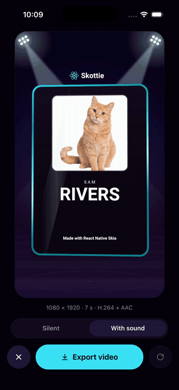
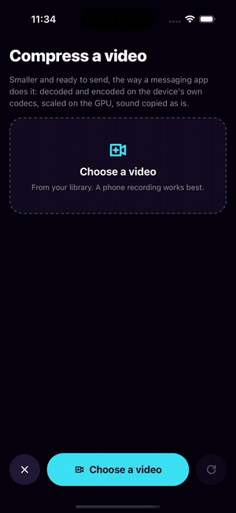

# react-native-webcodecs

The [WebCodecs API](https://developer.mozilla.org/en-US/docs/Web/API/WebCodecs_API)
for React Native, on the phone's own codecs: VideoToolbox and AudioToolbox on
iOS, MediaCodec on Android. Encode what you draw with WebGPU into an MP4, or
decode a video straight into a WebGPU texture, with the same code that runs
in a browser.

<p align="center">
  
  
</p>
<p align="center"><sub>Left: the example app exports a 1080×1920 Lottie animation with sound in 3.2 s on the iOS Simulator. Right: the MP4 it wrote.</sub></p>

<p align="center">
  <a href="https://andreialecu.github.io/react-native-webcodecs/"><b>Try the live demo</b></a>
  <br />
  <sub>The same example app in your browser: draw, encode and download an MP4, in SDR or HDR. Needs WebCodecs and WebGPU (tested in Chrome).</sub>
</p>

It does the codec work and nothing else. The rest comes from libraries that
already do it well, as on the web:

- [Mediabunny](https://mediabunny.dev) reads and writes MP4 and WebM.
- [React Native WebGPU](https://github.com/wcandillon/react-native-webgpu)
  draws the frames, or reads the decoded ones.
- [React Native Skia](https://shopify.github.io/react-native-skia/) is one
  way to draw them, Lottie animations included.

Frames stay on the GPU the whole way: the libraries pass native surfaces and
GPU fences between them, never pixels through JavaScript.

**Status:** young (0.x). Tested on the iOS Simulator, an Android emulator, one
iPhone and, for the web build, Chromium. H.264 and AAC everywhere, HEVC on
iOS, HDR export on iOS, Android and the web. Some paths need
[changes not yet released](#unreleased-changes-in-other-libraries) in other
libraries.

## Installation

```sh
yarn add react-native-webcodecs react-native-nitro-modules mediabunny
cd ios && pod install
```

React Native 0.76 or later, Nitro Modules 0.37 or later. Android API 26 or
later, and API 29 (Android 10) or later to encode video.

Call `installWebCodecs()` once, before Mediabunny is used. It puts the
WebCodecs classes on `globalThis`, and does nothing on the web, where the
browser has its own.

```ts
import { installWebCodecs } from "react-native-webcodecs";

installWebCodecs();
```

## Codecs

| | iOS | Android | Web |
| :-- | :-- | :-- | :-- |
| H.264 | Encode, decode | Encode (Android 10+), decode | The browser's |
| HEVC | Encode (Main, Main 10), decode | No | The browser's |
| AV1 | No | Encode where the device has an encoder (Main 10 tested) | The browser's |
| AAC | Encode, decode | Encode, decode | The browser's |
| MP3 | Decode | Decode | The browser's |
| HDR (HLG, BT.2020) | HEVC Main 10 | AV1 Main 10 | VP9 Profile 2 in Chromium |

Ask a device what it can do with `VideoEncoder.isConfigSupported(config)`,
as on the web. The [API reference](docs/api.md) says how far each answer
can be trusted, and which parts of the WebCodecs specification are
implemented.

## Export frames drawn with WebGPU

Draw each frame into a surface from a pool, hand the surface to the encoder
with the GPU fence of the draw, and let Mediabunny write the MP4:

```ts
import {
  createFileWritable,
  createSurfacePool,
  VideoFrame,
  withBackgroundTask,
} from "react-native-webcodecs";
import {
  Mp4OutputFormat,
  Output,
  Quality,
  StreamTarget,
  VideoSample,
  VideoSampleSource,
} from "mediabunny";

const WIDTH = 1080;
const HEIGHT = 1920;
const FRAME_RATE = 30; // frames per second
const FRAME_COUNT = 7 * FRAME_RATE; // a 7 s video
const BITRATE = 8_000_000; // bits per second (8 Mbps)
const MICROSECONDS_PER_SECOND = 1_000_000; // WebCodecs times are in µs
const FRAME_DURATION = MICROSECONDS_PER_SECOND / FRAME_RATE;

const file = createFileWritable("export.mp4"); // in the cache directory
const output = new Output({
  format: new Mp4OutputFormat(),
  target: new StreamTarget(file.writable),
});
const video = new VideoSampleSource({ codec: "avc", quality: new Quality({ bitrate: BITRATE }) });
output.addVideoTrack(video, { frameRate: FRAME_RATE });
await output.start();

const pool = createSurfacePool(WIDTH, HEIGHT);
for (let i = 0; i < FRAME_COUNT; i++) {
  const surface = pool.acquire();
  const buffer = RNWebGPU.createNativeBufferFromPointer(surface.pixelBuffer);
  const memory = device.importSharedTextureMemory({ source: buffer });
  const texture = memory.createTexture();
  memory.beginAccess(texture, false);
  draw(texture, i); // your render passes, then device.queue.submit()
  const { fences } = memory.endAccess(texture);
  texture.destroy();
  memory.destroy();
  buffer.release();

  const frame = new VideoFrame(surface, {
    timestamp: i * FRAME_DURATION,
    duration: FRAME_DURATION,
    fence: fences[0], // the encoder waits for it natively
  });
  const sample = new VideoSample(frame);
  try {
    await video.add(sample); // resolves once the encoder has room
  } finally {
    sample.close();
  }
}
video.close();
await withBackgroundTask(() => output.finalize()); // finishes if the app is backgrounded
console.log(file.path);
```

To stop early, `await output.cancel()` and `file.remove()`.

<details>
<summary>What each step does</summary>

1. `createFileWritable(path)` returns a `WritableStream` for Mediabunny's
   `StreamTarget`. It writes natively, at the positions Mediabunny asks for
   (Mediabunny goes back to fill in the MP4 header).
2. `createSurfacePool(width, height)` returns recycled GPU surfaces, so a
   long export reuses a handful instead of allocating one per frame.
3. React Native WebGPU imports the surface as a texture. `endAccess()`
   returns the fence the GPU signals once the draw is done.
4. `new VideoFrame(surface, { timestamp, duration, fence })` wraps the
   surface. The encoder waits for the fence on the native side, so
   JavaScript never waits for the GPU, and drawing the next frame overlaps
   with encoding this one.
5. `await video.add(sample)` is what keeps memory bounded: it waits while the
   encoder is full.
6. `withBackgroundTask()` keeps the app alive while `finalize()` runs, so an
   export the user leaves near the end still completes on iOS.

</details>

## More guides

- [Export a Lottie animation drawn by Skia](docs/guides.md#export-a-lottie-animation-drawn-by-skia)
- [Add sound](docs/guides.md#sound): copy an AAC track, or encode from MP3 or
  AAC.
- [Read video into WebGPU](docs/guides.md#read-video-into-webgpu): decode a
  frame and import it as a texture, without a copy.
- [Compress a video](docs/guides.md#compress-a-video): make a phone
  recording small enough to send, the way a messaging app does.
- [Export in HDR](docs/hdr.md): HLG in BT.2020, as HEVC Main 10 on iOS, AV1
  Main 10 on Android, VP9 Profile 2 in a browser.
- [On the web](docs/web.md): the same code with the browser's WebCodecs.

Reference and background:

- [API](docs/api.md): checking support, what each class implements,
  errors, and backgrounding.
- [How it works](docs/how-it-works.md): surfaces, fences, backpressure, and
  what each platform does.

## Try it

The [example app](example) exports the card in the GIFs above, with sound,
in SDR or HDR, and compresses a video you pick. It runs on iOS, on Android,
on an Apple silicon Mac (as an iPad app), and in a browser, where it is a
single page: [the live demo](https://andreialecu.github.io/react-native-webcodecs/).
See [CONTRIBUTING.md](CONTRIBUTING.md#the-example-app) to run it.

<p align="center">
  
</p>
<p align="center"><sub>A 20-second 1080p HEVC phone video, 40.3 MB, compressed to 720p H.264: 5.3 MB, in 3.2 s on the iOS Simulator. <a href="docs/guides.md#compress-a-video">How it works</a>.</sub></p>

## Unreleased changes in other libraries

Some paths need changes that are not released yet. This repository applies
them as Yarn patches (`.yarn/patches`); an app needs the same until they
ship.

| Change | Needed for |
| :-- | :-- |
| [wcandillon/react-native-webgpu#642](https://github.com/wcandillon/react-native-webgpu/pull/642) | Correct colors when reading decoded video into WebGPU on Android. |
| [wcandillon/react-native-webgpu#643](https://github.com/wcandillon/react-native-webgpu/pull/643) | HDR preview on a WebGPU canvas on iOS 26. Exports do not need it. |
| [wcandillon/react-native-skia#4510](https://github.com/wcandillon/react-native-skia/pull/4510) | Skia drawing into pool surfaces on the Android emulator. Real devices do not need it. |

## Acknowledgements

Set up from [William Candillon](https://github.com/wcandillon)'s
[React Native WebGPU](https://github.com/wcandillon/react-native-webgpu)
repository (its tooling, example app and e2e harness), and based on his idea
of exporting video through WebCodecs and Mediabunny rather than a video
writer built into React Native WebGPU
([wcandillon/react-native-webgpu#641](https://github.com/wcandillon/react-native-webgpu/pull/641)).
The example uses the animation, photo and logo from
[react-native-skia's Skottie export example](https://github.com/wcandillon/react-native-skia/pull/4505).
The native bridge is [Nitro Modules](https://nitro.margelo.com).

The `WritableStream` installed on Hermes follows the behavior of
[web-streams-polyfill](https://github.com/MattiasBuelens/web-streams-polyfill)
by Mattias Buelens (MIT License) and the
[WHATWG Streams Standard](https://streams.spec.whatwg.org/).

## License

MIT
