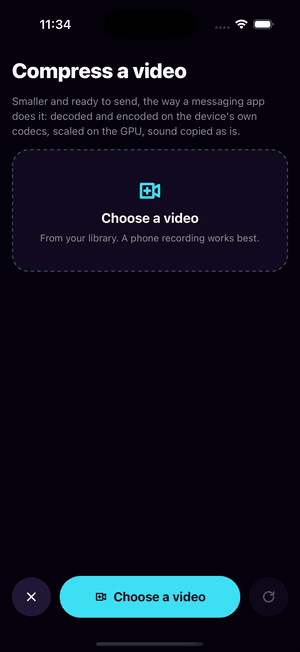

# Guides

[README](../README.md) · [Guides](guides.md) · [HDR](hdr.md) · [Web](web.md) · [API](api.md) · [How it works](how-it-works.md)

- [Export a Lottie animation drawn by Skia](#export-a-lottie-animation-drawn-by-skia)
- [Sound](#sound)
- [Read video into WebGPU](#read-video-into-webgpu)
- [Compress a video](#compress-a-video)

## Export a Lottie animation drawn by Skia

[React Native Skia](https://shopify.github.io/react-native-skia/) plays
Lottie files with Skottie, and draws on a WebGPU device that
react-native-webgpu can import. For each frame: seek the animation, render
it into a pool surface, and hand the surface to the encoder with the draw's
fence.

```ts
import { Skia } from "react-native-skia";
import { importDevice } from "react-native-webgpu";
import {
  createFileWritable,
  createSurfacePool,
  installWebCodecs,
  VideoFrame,
} from "react-native-webcodecs";
import {
  Mp4OutputFormat,
  Output,
  Quality,
  StreamTarget,
  VideoSample,
  VideoSampleSource,
} from "mediabunny";

installWebCodecs();

const animation = Skia.Skottie.Make(lottieJson, assets);
const { width, height } = animation.size();
const fps = animation.fps();
const frames = Math.round(animation.duration() * fps);
const BITRATE = 8_000_000; // bits per second (8 Mbps)
const MICROSECONDS_PER_SECOND = 1_000_000; // WebCodecs times are in µs
const frameDuration = MICROSECONDS_PER_SECOND / fps;
const device = importDevice(Skia.getNativeDevice()); // Skia's own device

const file = createFileWritable("lottie.mp4");
const output = new Output({
  format: new Mp4OutputFormat(),
  target: new StreamTarget(file.writable),
});
const video = new VideoSampleSource({ codec: "avc", quality: new Quality({ bitrate: BITRATE }) });
output.addVideoTrack(video, { frameRate: fps });
await output.start();

const pool = createSurfacePool(width, height);
for (let i = 0; i < frames; i++) {
  const surface = pool.acquire();
  const buffer = RNWebGPU.createNativeBufferFromPointer(surface.pixelBuffer);
  const memory = device.importSharedTextureMemory({ source: buffer });
  const texture = memory.createTexture();
  memory.beginAccess(texture, false);
  const skSurface = Skia.Surface.MakeFromGPUTexture(texture)!;
  animation.seekFrame(i);
  animation.render(skSurface.getCanvas());
  skSurface.flush();
  const { fences } = memory.endAccess(texture);
  skSurface.dispose();
  texture.destroy();
  memory.destroy();
  buffer.release();
  const frame = new VideoFrame(surface, {
    timestamp: i * frameDuration,
    duration: frameDuration,
    fence: fences[0],
  });
  // Mediabunny is typed for the DOM's VideoFrame; this one stands in for it.
  const sample = new VideoSample(frame as unknown as globalThis.VideoFrame);
  try {
    await video.add(sample);
  } finally {
    sample.close();
  }
}
video.close();
await output.finalize();
```

The texture must belong to Skia's own device, hence `importDevice(Skia.getNativeDevice())`.
On the Android emulator, Skia's device importing the pool's buffers needs
react-native-skia 3.11.1 or later. Real devices are not affected.

## Sound

Sound goes through Mediabunny, in one of two ways:

- **Copy AAC as is** with an `EncodedAudioPacketSource`. Nothing is decoded
  or encoded.
- **Encode decoded samples** with an `AudioSampleSource` and
  `codec: "aac"`. It encodes with `AudioEncoder` (AAC-LC). MP3 and AAC decode
  through `AudioDecoder`, so either can be the source.

Read the sound file with `fileSourceOptions`:

```ts
import { fileSourceOptions } from "react-native-webcodecs";
import { ALL_FORMATS, CustomSource, Input } from "mediabunny";

const input = new Input({
  source: new CustomSource(fileSourceOptions(path)),
  formats: ALL_FORMATS,
});
const audioTrack = await input.getPrimaryAudioTrack();
```

The example app copies a sound track from an M4A file into its export; the
e2e tests also transcode an MP3 to AAC and cut the sound where the video
ends.

## Read video into WebGPU

Mediabunny demuxes the file and drives `VideoDecoder`. The decoded
`VideoFrame` exposes its native buffer, which react-native-webgpu imports
without a copy.

```ts
import {
  fileSourceOptions,
  installWebCodecs,
  type VideoFrame,
} from "react-native-webcodecs";
import { ALL_FORMATS, CustomSource, Input, VideoSampleSink } from "mediabunny";

installWebCodecs();
const input = new Input({
  source: new CustomSource(fileSourceOptions(path)),
  formats: ALL_FORMATS,
});
const track = await input.getPrimaryVideoTrack();
const sample = await new VideoSampleSink(track).getSample(1.5);
// This package's VideoFrame, typed as the DOM's by Mediabunny.
const frame = sample.toVideoFrame() as unknown as VideoFrame;
sample.close();

const buffer = RNWebGPU.createNativeBufferFromPointer(frame.pixelBuffer, {
  colorSpace: frame.nativeBufferColorSpace,
});
device.queue.copyExternalImageToTexture(
  { source: buffer },
  { texture },
  [width, height],
);
buffer.release();
frame.close();
```

| Platform | Decoded frame |
| :-- | :-- |
| iOS | A BGRA `CVPixelBuffer` by default; NV12 with `outputFormat: "NV12"` in the decoder config. |
| Android | The decoder's own YUV (NV12) `AHardwareBuffer`. It can be wider or taller than the frame (software decoders pad the width to a multiple of 128): the picture is its top-left `codedWidth` x `codedHeight`, so sample only that. |

The frame's `colorSpace` comes from the stream (Mediabunny passes the
track's to `configure`; on Android, what the config leaves out is what the
decoder reads in the stream). Android's buffers carry no color information
of their own, so pass it to `createNativeBufferFromPointer`: without it,
BT.709 video is read with the BT.601 matrix, and pure red comes out as
(225, 0, 31). The option takes react-native-webgpu 0.26.0 or later, and
names color spaces as Dawn does (`"rec709"`, `range: "narrow"`), not as
WebCodecs does (`"bt709"`, `fullRange: false`): `frame.nativeBufferColorSpace`
is the frame's `colorSpace` in those names. On iOS the pixel buffer has its
own, and passing it changes nothing.

Close every frame when you are done with it. Android's decoder stalls while
JavaScript holds all of its output frames.

## Compress a video

<p align="center">
  
</p>

A phone records at 15 to 20 Mbps. A messaging app re-encodes the video
before sending it: smaller, at a lower bitrate, with the sound copied as
is. Mediabunny's `Conversion` does the demuxing, decoding, timing and the
audio copy. Its own resizer needs a canvas, so on a device the frames are
scaled with WebGPU in its `process` hook instead.

```ts
import {
  ALL_FORMATS, Conversion, CustomSource, Input, Mp4OutputFormat, Output,
  Quality, StreamTarget,
} from "mediabunny";
import type { Rotation } from "mediabunny";
import { createFileWritable, fileSourceOptions } from "react-native-webcodecs";

const VIDEO_BITRATE = 2_000_000; // bits per second, for 720p

const input = new Input({
  source: new CustomSource(fileSourceOptions(path)),
  formats: ALL_FORMATS,
});
const videoTrack = await input.getPrimaryVideoTrack();
const rotation = videoTrack ? await videoTrack.getRotation() : 0;
const file = createFileWritable("compressed.mp4");
const output = new Output({
  // The index first, so the file plays while it downloads.
  format: new Mp4OutputFormat({ fastStart: "reserve" }),
  target: new StreamTarget(file.writable),
});
const conversion = await Conversion.init({
  input,
  output,
  video: {
    codec: "avc",
    quality: new Quality({ bitrate: VIDEO_BITRATE }),
    forceTranscode: true,
    // A phone's portrait video is stored landscape with a rotation tag:
    // undo the tag and turn the frames upright while scaling them.
    rotate: ((360 - rotation) % 360) as Rotation,
    processedWidth: 720,
    processedHeight: 1280,
    process: (sample) => scaleOnTheGpu(sample), // returns a VideoSample
  },
});
await conversion.execute();
```

`scaleOnTheGpu` imports the decoded frame as a texture (as in
[Read video into WebGPU](#read-video-into-webgpu)), draws it into a
surface from `createSurfacePool(720, 1280)` and returns
`new VideoSample(new VideoFrame(surface, { timestamp, duration, fence }))`.
The example's [`compress.ts`](../example/src/Compress/compress.ts) is a
complete version. It picks the bitrate from the size, frame rate and
codec, and asks `VideoEncoder.isConfigSupported` which codecs the device
can encode. In a browser, Mediabunny's `width` and `height` options do the
scaling ([`compress.web.ts`](../example/src/Compress/compress.web.ts)).

A 20-second 1080p phone video at 16 Mbps (40 MB) comes out at 720p and
2 Mbps as about 5 to 6 MB: in 1.8 s in Chrome on a Mac, 3.2 s on the iOS
Simulator, and 9.6 s on an Android emulator.
